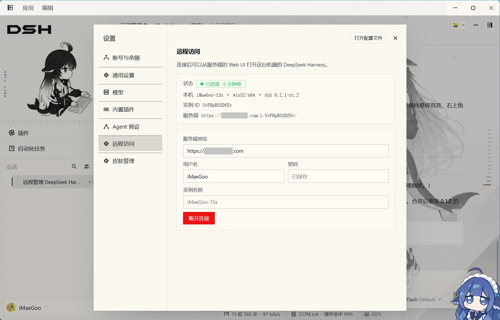
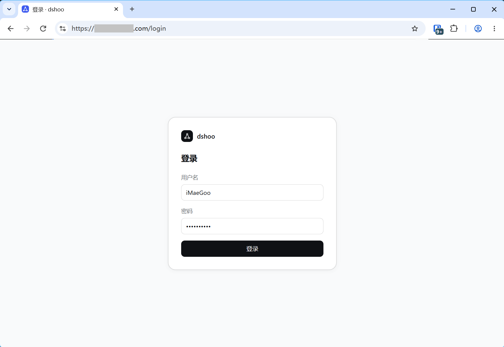
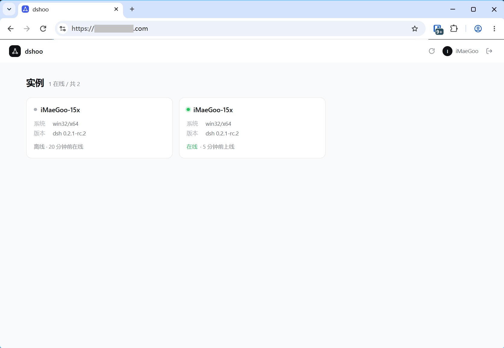
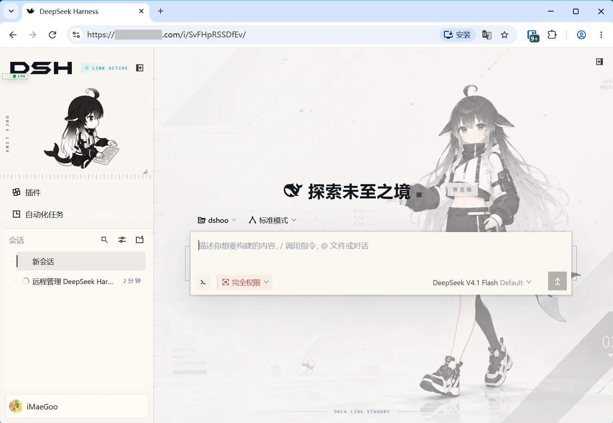

# dshoo

远程管理多台设备上的 DeepSeek Harness：在一台公网服务器上登录一个 Web UI，看到所有管理的实例，点开就是那台机器上真实运行的 dsh 界面——同一份工作区、同一份会话记录，可以直接继续对话和跑任务。

- **服务端**：Go + SQLite，单二进制，Docker 部署，监听 `9830`。
- **插件**：TypeScript，安装后 dsh 设置里多出「远程访问」，填服务器地址和账号即可上线。

实例侧不开放任何入站端口：插件主动向服务器建立 WebSocket，服务器把浏览器的 HTTP 与 WebSocket 拆成帧走这条隧道。

## 快速开始

### 1. 启动服务端

```sh
docker compose up -d
```

或使用发布页的二进制（Windows / Linux / macOS，x64 与 arm64）：

```sh
DSHOO_DATA=./data ./dshoo-<version>-linux-x64
```

打开 `http://<服务器>:9830`，**首次访问会要求创建账号和密码**，之后每次访问都需要登录。

### 2. 在设备上安装插件

**方式一：在桌面版里安装（推荐）**

打开 DeepSeek Harness 桌面版，点击左侧 **插件 → 添加插件**，输入插件包名 `dshoo`，点击**安装**，装好后点击**立即启用**。

**方式二：命令行**

```sh
dsh plugin --profile web add dshoo
```

桌面版用 `--profile desktop`。装完重启一次 dsh。

无论用哪种方式，装好后打开 **设置 → 远程访问**，填写服务端地址、用户名、密码，点「连接」。



连接成功后这台实例出现在服务端的实例列表里；只要 dsh 在运行就会自动重连（断线后约 1 秒重试，连不上时每 10 秒），点「断开连接」才会停止自动连接。

### 3. 从服务端打开实例



登录后是一页实例卡片，点任意一张卡片就直接进入那台机器的 dsh 界面（同一份工作区与会话）。离线实例的卡片会标出来，可以就地移除记录。





远程打开的实例左上角有一个胶囊：返回实例列表，以及当前链路延迟（绿 ≤ 120ms、黄 ≤ 300ms、红 > 300ms）。这个胶囊只出现在远程页面里，本机直接打开 dsh 时没有。

## 配置

服务端全部通过环境变量配置：

| 变量 | 默认 | 说明 |
| --- | --- | --- |
| `DSHOO_ADDR` | `:9830` | 监听地址 |
| `DSHOO_DATA` | `./data` | 数据目录（SQLite 位于 `dshoo.db`） |
| `DSHOO_SESSION_DAYS` | `7` | 登录会话有效期（天） |
| `DSHOO_PUBLIC_URL` | 空 | 对外地址；为 `https://` 时会话 cookie 自动带 `Secure` |
| `DSHOO_SECURE_COOKIE` | 依 `DSHOO_PUBLIC_URL` | 强制会话 cookie 只走 HTTPS |
| `DSHOO_TRUST_PROXY` | `false` | 前置反向代理时信任 `X-Forwarded-For` |
| `DSHOO_DEBUG` | `0` | `1` 打开逐请求日志 |

忘记密码：

```sh
docker compose exec -e DSHOO_NEW_PASSWORD='新密码' dshoo /usr/local/bin/dshoo -passwd -user admin
```

## 安全提示

服务端账号等于这些实例的最高权限——dsh 可以在本机执行命令。请务必把 `9830` 放在 HTTPS 反向代理后面（Caddy / Nginx / Cloudflare），否则登录凭据是明文传输。

## 开发

见 [AGENTS.md](AGENTS.md)。

## License

[MIT](LICENSE) © 2026-present iMaeGoo
